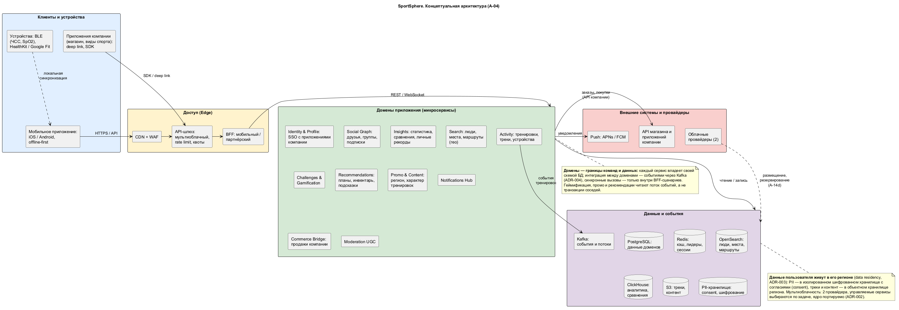

# А-04. Концептуальная архитектура

> Этап 1 · Утверждение концепта. **Главный документ**: от него расходятся
> все остальные — детализация идёт в А-13 (базовая архитектура) и А-14
> (представления).

> Исходник: [`diagrams/d1_conceptual.png`](../../diagrams/d1_conceptual.png).

## Слои и их ответственность

### 1. Клиенты и устройства
- **Мобильное приложение (iOS/Android)** — offline-first: тренировка
  записывается в локальный журнал и синхронизируется при появлении сети
  (FR-14, ADR-006). Фитнес-функции телефона (FR-12) и BLE-устройства
  (FR-09) подключаются через адаптеры клиента, нормализованный поток
  уходит в Activity.
- **Приложения компании** — существующие приложения покупки и видов
  спорта: deep link и SDK, единый вход (FR-10, ADR-009, ADR-010).
  В схеме — как внешний потребитель/поставщик, не как часть ядра.

### 2. Доступ (Edge)
- **CDN + WAF** — статика, кэш, DDoS, анти-бот (риски 12.5).
- **API-шлюз** — единая точка входа: аутентификация токеном, квоты и
  rate limit по пользователю и партнёру, маршрутизация (ADR-005,
  наработки практики `13.5` — шлюзы по типу коммуникации).
- **BFF** — два: мобильный (сборка лент/экранов) и партнёрский
  (узкий контракт для приложений компании). BFF — единственное место,
  где складываются данные нескольких доменов для экрана.

### 3. Домены приложения (микросервисы)
Границы = границы команд и данных (ADR-001). Внутри домена — свои
таблицы; между доменами — только события (ADR-004).

| Домен | Ответственность | ФТ |
|-------|-----------------|----|
| Identity & Profile | Аккаунт, SSO с приложениями компании, профиль, согласия-ссылки | FR-10, FR-15 |
| Social Graph | Друзья, группы, подписки, уведомления «кому показать» | FR-01, FR-06 |
| Activity | Приём тренировок и потоков устройств, офлайн-синхронизация, владение треками | FR-09, FR-12, FR-14 |
| Insights | Личная статистика, сравнения, личные рекорды (читает поток событий) | FR-02 |
| Search (гео) | Люди, места, маршруты, «тренируются сейчас» | FR-03 |
| Challenges & Gamification | Очки, достижения, челленджи, соревнования | FR-07, FR-13 |
| Recommendations | Планы тренировок, подсказки по инвентарю и замене обуви | FR-04, FR-05 |
| Promo & Content | Промо-движок, новости, региональные сегменты | FR-08, FR-11 |
| Notifications Hub | Push/in-app с приоритетами и квотами, дедупликация | FR-06, FR-08 |
| Commerce Bridge | Мост в приложения компании: deep link, атрибуция, квоты | FR-10 (Ц-2) |
| Moderation UGC | Автопроверка и очередь ревью публикаций групп | FR-01 |

### 4. Данные и события
- **Kafka** — шина событий: домены публикуют, соседи читают
  (ADR-004). Порядок по ключу пользователя.
- **PostgreSQL** — оперативные данные доменов, по регионам
  (ADR-003: данные пользователя — в его регионе).
- **Redis** — кэш, сессии, live-лидерборды (ADR-008).
- **OpenSearch** — гео- и социальный поиск (ADR-007).
- **ClickHouse** — аналитика сравнений, исторические срезы (ADR-008).
- **S3** — треки, медиа контента, холодные данные.
- **PII-хранилище** — персональные данные отдельно, под KMS,
  с журналом согласий (ADR-003).

### 5. Внешние системы и провайдеры
Push (APNs/FCM), API магазина и приложений компании (mTLS),
**два облачных провайдера** — 90 % систем в облаке, выбор провайдера по задаче:
инфраструктура описана в А-14d
и схеме `d6_infrastructure.png` (наработки практики `14.5`).

## Ключевые потоки (концептуально)

1. **Тренировка**: клиент (офлайн или online) → шлюз → BFF → Activity →
   Kafka → Insights (статистика), Challenges (очки), Recommendations
   (подсказки), Notifications (друзьям). Детально — сценарии [А-07](07-critical-scenarios.md)
   и А-12.
2. **Покупка (Ц-2)**: Recommendations → Commerce Bridge → deep link в
   приложение компании → атрибуция возвращается в Commerce Bridge →
   Kafka (событие конверсии).
3. **Социальное**: публикация → Moderation → Social Graph → Notifications
   и лента; группы самоподдерживаются ролями и модерацией.
4. **Соревнование (пик)**: Activity → Kafka → Challenges → Redis
   (live-позиции) → WebSocket-диффузия; масштабирование — А-14c.

## Ограничения концепта (откуда взялись)

| Ограничение | Источник | Влияние на схему |
|-------------|----------|------------------|
| Нет единого облачного провайдера, best-of-breed | Контекст задания | Портируемое ядро: K8s + Terraform, адаптеры вместо SDK (ADR-002) |
| Данные пользователей по всему миру | Особенность 1, NFR-04 | Региональные кластеры данных + PII-хранилище (ADR-003) |
| Массовые соревнования | Особенность 2, FR-13 | Выделенный поток Kafka + Redis-лидерборды, эластичность (А-14c) |
| Сторонние устройства и телефон | Особенности 3–4, FR-09/12 | Адаптеры на клиенте, единый нормализованный поток в Activity |
| Охрана данных | Особенность 5, FR-15 | Отдельная зона данных, согласия, JIT-доступ (А-14e) |
| Не всё требование одинаково важно | Особенность 6 | MoSCoW в [А-02](02-functional-requirements.md), фазы в [А-06](06-roadmap.md) |

## Связи

- Почему выбраны микросервисы, а не монолит/серверлесс: [А-10](10-architecture-options.md).
- Решения, зафиксированные как ADR: 001–012 — ADR.
- Детализация с технологиями и адресация атрибутов качества: А-13.
- Риски этой концепции: [А-05](05-risks.md), компромиссы после реализации: А-15.
