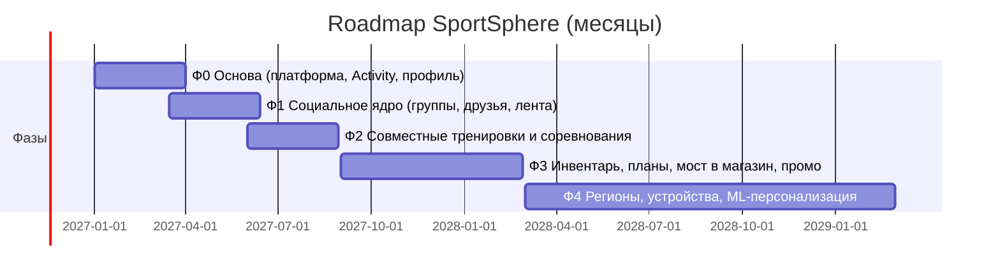

# А-06. План поэтапной разработки и расширения системы

> Этап 1 · Утверждение концепта. Требование этапа: показать очерёдность
> реализации бизнес-требований и соотношение с концептуальной схемой
> ([А-04](04-conceptual-architecture.md)), выделить критически важные
> компоненты каждой фазы.

## Общая логика

Порядок фаз определяется **зависимостью ценности**: сначала то, что
работает в одиночку (тренировка + статистика), затем социальное (удержание),
затем виральность и пиковые нагрузки, затем монетизация, затем расширение.
Каждая фаза — независимый релизный контур; фазы могут частично
нахлестываться разными командами.

## Фазы

### Фаза 0 — «Основа» (месяцы 0–3)
- **Бизнес-ценность**: первый запуск в одном регионе: запись тренировки,
  офлайн, базовая статистика «сравнение с собой».
- **ФТ**: FR-09, FR-12, FR-14 (ядро), FR-15, FR-02 (базовый уровень),
  вход по SSO (FR-10 частично).
- **Компоненты схемы А-04**: Edge (CDN/WAF/шлюз/BFF), Identity, Activity,
  PII-хранилище, PostgreSQL/Redis/S3, минимальная наблюдаемость.
- **Критически важные компоненты**: Activity-приём (потоки и офлайн-журнал),
  Identity/SSO, контур CI/CD и мониторинга — **без них не стартует ни одна
  следующая фаза**. Сбой = потеря всех данных тренировок.

### Фаза 1 — «Социальное ядро» (месяцы 3–6)
- **Бизнес-ценность**: Ц-1 — удержание: группы, друзья, реакции.
- **ФТ**: FR-01, FR-06, FR-02 (полные сравнения), модерация.
- **Компоненты**: Social Graph, Notifications Hub, Insights, Moderation,
  событийная шина (Kafka) — вступает в работу как «нервная система».
- **Критически важные**: Social Graph (целостность связей) и
  Notifications Hub (доставка уведомлений = виральная петля Ц-3).

### Фаза 2 — «Совместно и соревнования» (месяцы 6–9)
- **Бизнес-ценность**: Ц-1 + Ц-3: поиск людей, совместные тренировки,
  геймификация, массовые соревнования.
- **ФТ**: FR-03, FR-07, FR-13.
- **Компоненты**: Search (гео), Challenges & Gamification, Redis-лидерборды,
  WebSocket-диффузия, эластичное масштабирование.
- **Критически важные**: гео-поиск (качество индекса — весь сценарий
  «найти рядом»), Competition-путь (пиковые нагрузки, риск T-02).

### Фаза 3 — «Монетизация» (месяцы 9–15)
- **Бизнес-ценность**: Ц-2: подсказки по инвентарю → покупка, промо.
- **ФТ**: FR-04, FR-05, FR-08, FR-10 (полноценно), FR-11 (базово).
- **Компоненты**: Recommendations, Promo & Content, Commerce Bridge
  (контракт с приложениями компании).
- **Критически важные**: Commerce Bridge (SLA внешней интеграции, риск
  B-03), Recommendations (качество подсказок влияет на конверсию).

### Фаза 4 — «Расширение» (месяцы 15–24)
- **Бизнес-ценность**: Ц-4 — глобальность и персонализация.
- **ФТ**: FR-11 (полноценно), расширение профилей устройств (FR-09+),
  ML-персонализация промо и планов.
- **Компоненты**: Promo-движок (ML), новые регионы/APAC, расширение
  библиотеки устройств, ClickHouse-срезы для сравнений с регионами.
- **Критически важные**: конвейер данных (события → ML → подача),
  мультиоблачное расширение регионов (А-14d).

## Соответствие: требование → фаза → компоненты А-04

| ФТ | Фаза | Компоненты А-04 |
|----|------|-----------------|
| FR-09, FR-12, FR-14, FR-15, FR-10 (част.) | 0 | Activity, Identity, PII, Edge |
| FR-01, FR-06, FR-02, модерация | 1 | Social Graph, Notifications, Insights, Moderation, Kafka |
| FR-03, FR-07, FR-13 | 2 | Search, Challenges, Redis, Activity (пик) |
| FR-04, FR-05, FR-08, FR-10, FR-11 | 3 | Recommendations, Promo, Commerce Bridge |
| FR-09+, FR-11 (полно), ML | 4 | Promo/Recommendations (ML), новые регионы |

**Полное покрытие**: 15 из 15 ФТ распределены — ни одно требование не
«потеряно» (проверка сходимости по совету №3 вводной части).

## Критически важные компоненты (сводно)

| Фаза | Критичный компонент | Почему | Резерв |
|------|---------------------|--------|--------|
| 0 | Activity-приём + офлайн-журнал | Потеря данных = потеря доверия | Redelivery, локальное хранение, аудит |
| 0 | Контур CI/CD и наблюдаемость | Скорость и диагностика всех фаз | GitOps-шаблоны, алерты (15.6) |
| 1 | Social Graph | Ядро Ц-1, трудно менять потом | Миграции версионируются, двойная запись на переходный период |
| 1 | Notifications Hub | Виральная петля (Ц-3) | Очереди + ретраи, резервный канал e-mail |
| 2 | Гео-поиск (индекс) | Весь сценарий совместных тренировок | Fallback на SQL-гео-запросы (ADR-007) |
| 2 | Competition-путь | Пик ×10 (риск T-02) | Квоты, «медленные» итоги, деградация по приоритетам |
| 3 | Commerce Bridge | Цель Ц-2, внешняя зависимость | Circuit breaker, резервный сценарий промо (B-03) |
| 4 | Конвейер данных → ML | Качество персонализации | Без ML: правила и сегменты (текущая логика) |

## Проверка сходимости

- **Горизонт**: 24 месяца до полного покрытия целей; Ц-1/Ц-3 проверяются
  метриками к концу фазы 2 (9 мес.), Ц-2 — к концу года 2.
- **Не выдумали лишнего**: каждая фаза содержит только FR из [А-02](02-functional-requirements.md)
  и компоненты из [А-04](04-conceptual-architecture.md); ничего сверх —
  нет ни одного «нового» требования.
- **Ресурсы**: 3 параллельных трека (социальный, платформа,
  монетизация) — укладывается в 40–60 разработчиков контекста задания.
- **Стоимость роста** по фазам — в А-16
  (год 1 ≈ фазы 0–2, год 2 ≈ фаза 3, год 5 ≈ фаза 4 + масштаб).
