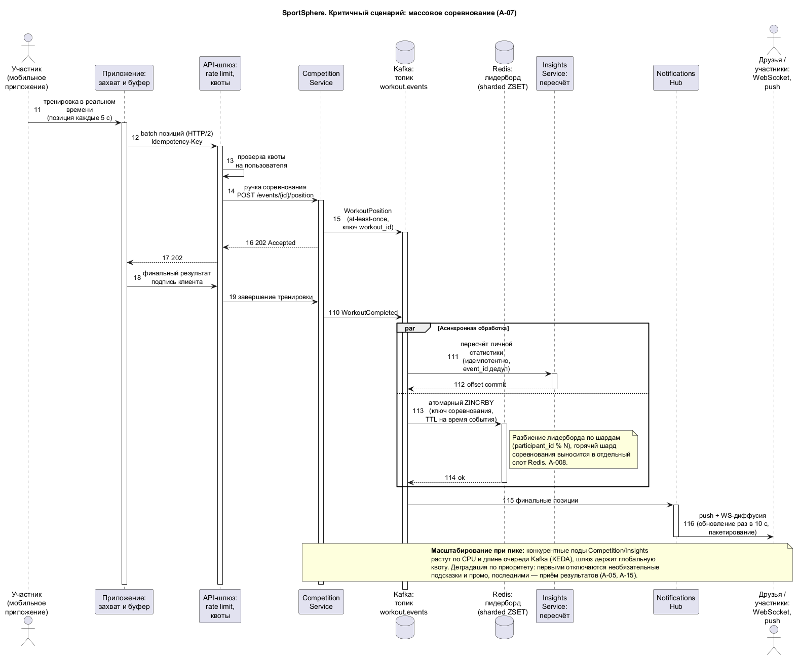

# А-07. Критические бизнес-сценарии

> Этап 1 · Утверждение концепта. Сценарий «критичен», если его сбой
> напрямую бьёт по бизнес-целям [А-01](01-business-goals.md).

## КС-1. Массовое соревнование (пик нагрузки)

- **Цели**: Ц-1, Ц-3. **Риски**: T-02.
- **Ход**: участники стартуют одновременно → клиенты шлюзуют позиции
  пачками → шлюз держит квоты → Competition-сервис кладёт позиции в
  Kafka → параллельно: пересчёт в Insights и атомарные обновления
  лидербордов в Redis → друзья видят живые позиции через WS/push.
- **Критичность**: сбой в прямом эфире виден тысячам одновременно.
- **Адресуется**: схема 
  (`d2_scenario_competition.png`), А-14c,
  ADR-004, ADR-008; приоритетная деградация: первыми — промо и подсказки,
  последним — приём результатов.
- **Критерий успеха**: приём результатов не прерывается на пике ×10;
  обновление таблицы лидеров ≤ 10 с.

## КС-2. Путь монетизации: тренировка → подсказка → покупка

- **Цели**: Ц-2. **Риски**: B-03.
- **Ход**: пользователь пробежал в обуви N км → Recommendations определяет
  износ по данным инвентаря → подсказка «пора обновить» с товаром →
  deep link открывает приложение компании → покупка → атрибуция
  возвращается в Commerce Bridge → событие конверсии в Kafka.
- **Критичность**: единственная прямая выручка от продукта.
- **Адресуется**: ADR-010 (контракт, mTLS, версии), circuit breaker и
  деградация «без подсказок» (наработки 10.5); резерв — баннеры промо.
- **Критерий успеха**: конверсия «подсказка → переход» ≥ 3 % (Ц-2);
  отказ внешнего API не влияет на остальные функции.

## КС-3. Виральный цикл: успех → друзья → приглашение

- **Цели**: Ц-1, Ц-3. **Риски**: B-01.
- **Ход**: личный рекорд → автопубликация (с настройками приватности) →
  Notifications Hub → друзья получают push и видят в ленте → реакции →
  «присоединяйся к челленджу» → приглашение нового пользователя.
- **Критичность**: главный источник органического роста.
- **Адресуется**: Notifications Hub с квотами (B-02), Social Graph,
  фиче-флаги для петли (11.5), дедупликация уведомлений.
- **Критерий успеха**: ≥ 40 % прироста из приглашений (Ц-3).

## КС-4. Офлайн-тренировка в «диких» местах

- **Цели**: Ц-1, Ц-4. **Риски**: T-03.
- **Ход**: нет сети → приложение пишет тренировку в локальный журнал
  (включая данные BLE) → при появлении сети — пакетная синхронизация
  с Idempotency-Key → при конфликте — правило слияния → события уходят
  в Kafka → статистика и уведомления досчитываются.
- **Критичность**: уникальное отличие (особенность 1): потеря записи =
  прямое нарушение обещания «тренируйся где угодно».
- **Адресуется**: ADR-006, А-14c
  (версии, дедуп, merge), тесты на потерю сети/обрыв батареи.
- **Критерий успеха**: 0 потерянных тренировок при обрывах до 24 ч.

## КС-5. Совместная тренировка: найти и встретиться

- **Цели**: Ц-1. **Риски**: —.
- **Ход**: фильтр «интересы / то же место / те же маршруты / тренируются
  сейчас» → Search (гео-индекс) → схема «встречи» (время, точка) →
  обе стороны получают уведомление → статус «тренируюсь сейчас»
  обновляется в реальном времени.
- **Критичность**: требование 3 целиком; зависит от качества индекса.
- **Адресуется**: ADR-007 (OpenSearch geo), приватность «сейчас»
  видно только при включённом статусе (FR-15).
- **Критерий успеха**: ответ поиска ≤ 500 мс, ≥ 20 % активных
  используют поиск в месяц.

## КС-6. Персонализация промо по характеру тренировок

- **Цели**: Ц-2, Ц-4. **Риски**: B-02, B-07.
- **Ход**: события тренировок → сегментация (тип, интенсивность,
  регион) → Promo-движок выбирает кампанию → подача в ленту/push с
  учётом квот → A/B-метрика → конверсия через Commerce Bridge.
- **Критичность**: промо — главный источник новых каналов продаж.
- **Адресуется**: Promo & Content как параметризованный движок
  (без релизов), квоты Notifications Hub, ручной режим региона.
- **Критерий успеха**: CTR промо выше баннеров «для всех»; жалобы
  на уведомления не растут (B-02).

## КС-7. Запрос/удаление данных (приватность)

- **Цели**: Ц-4. **Риски**: B-04, T-05.
- **Ход**: пользователь запрашивает выгрузку/удаление → Identity
  собирает пакет по доменам (PII-хранилище + оперативные данные) →
  выгрузка выдаётся, удаление помечает данные и чистит производные
  копии (кэши, индексы) по регламенту → журнал операции.
- **Критичность**: юридически критичен (GDPR Art. 15/17), репутационно —
  прямая связь с Ц-4.
- **Адресуется**: ADR-003 (PII-изоляция — «всё в одном месте»),
  доменные события на очистку (ADR-004), аудит (А-14e).
- **Критерий успеха**: полный ответ ≤ 30 дней, удаление производных ≤ 7 дней.

## Сводка

| Сценарий | Цель | Фаза ([А-06](06-roadmap.md)) | Схема/представление |
|----------|------|------|----------------------|
| КС-1 Соревнование | Ц-1, Ц-3 | 2 | `d2_scenario_competition`, А-14c |
| КС-2 Путь покупки | Ц-2 | 3 | А-14a, ADR-010 |
| КС-3 Виральная петля | Ц-1, Ц-3 | 1 | А-14a |
| КС-4 Офлайн | Ц-1, Ц-4 | 0 | А-14c, ADR-006 |
| КС-5 Совместная тренировка | Ц-1 | 2 | А-14b, ADR-007 |
| КС-6 Персонализация промо | Ц-2, Ц-4 | 3–4 | А-14a |
| КС-7 Приватность | Ц-4 | 0 | А-14e, ADR-003 |
