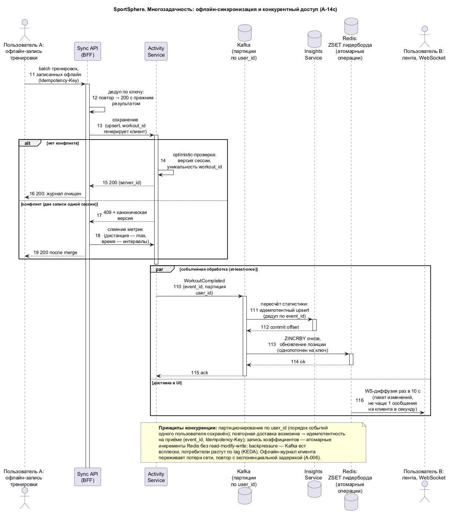

# А-14c. Многозадачность (concurrency)

> Исходник: `diagrams/d5_concurrency.png`. Схема показывает два
> конкурирующих потока: офлайн-синхронизацию (запись) и асинхронное
> разнесение результата (чтение тысячами потребителей).

## Модель конкурентности

| Уровень | Механизм | Гарантия |
|---------|----------|----------|
| Клиент | Локальный журнал + батч-синхронизация, `Idempotency-Key`, `workout_id` от клиента (ADR-006) | Повтор не создаёт дубль; обрыв не теряет запись |
| HTTP-приём | Дедуп по ключу → `200` с прежним результатом | Exactly-once на входе (по сути) |
| Конфликт двух записей сессии | Версия сессии → `409` → правило слияния (интервалы/максимумы) | Детерминированный результат, обновляемое правило |
| Шина | Kafka, ключ партиции = `user_id`, at-least-once + дедуп по `event_id` (ADR-004) | Порядок событий одного пользователя сохранён |
| Пересчёт | Идемпотентные upsert в Insights/ClickHouse | Дубль события не искажает статистику |
| Live-состояние | Redis: только атомарные инкременты (`ZINCRBY`), один потребитель на ключ (ADR-008) | Нет read-modify-write гонок |
| UI-поток | WebSocket-диффузия пакетами: ≤ 10 с на обновление, ≤ 1 сообщения/сек клиенту | Нет перегрузки клиента на пике |
| Масштабирование | KEDA: поды по CPU/лагу, шарды Redis по `participant_id % N` | Пик ×10 без превью постоянно |

## Правила, которые закреплены в шаблоне сервиса (проверяются тестами)

1. **Вход идемпотентен**: любой приём повторяем (ретраи безопасны).
2. **Состояние не пересчитывается в двух местах**: агрегат на пользователя
   считает один владелец (ключ в Kafka).
3. **Никаких распределённых лок по умолчанию**: горячее — атомарные
   операции Redis; долгие транзакции запрещены (более 2 обращений к БД —
   пересмотр на ревью).
4. **Backpressure через очередь, не через отказ**: Kafka впитывает всплеск,
   потребители растут по лагу; если лаг далёкий — деградация необязательных
   функций (промо), а не приёма.
5. **Порядок для пользователя, не для мира**: глобальный порядок не
   нужен; соревновательные таблицы допускают «предварительность» до
   сверки итогов.

## Офлайн-сценарий (детально, UC-03/КС-4)

1. Тренировка пишется append-only с локальными монотонными метками.
2. При сети — батч последних неподтверждённых записей (проверка
   `acked_seq`); сервер подтверждает `received_seq` — дальше журнал
   сокращается.
3. Потеря подтверждения → повтор батча → дедуп; конфликт разных устройств
   → 409 + merge; «мёртвые» батчи старше 30 дней → свёртка в сводку.

## Пик соревнования (связь с КС-1)

Схема [`d2_scenario_competition.png`](../../../diagrams/d2_scenario_competition.png):
партиции Kafka по участникам, параллельные ветки пересчёта и рейтинга,
приоритеты деградации. Оценки: пик 20 тыс. позиций/с (design target
50 тыс./с), обновление таблицы ≤ 10 с — см. [А-08](../../stage1-concept/08-quality-attributes.md).
