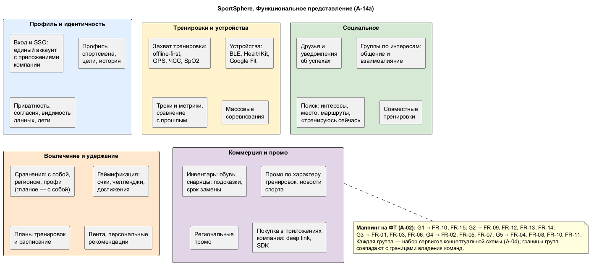

# А-14a. Функциональное представление

> Исходник: `diagrams/d3_functional.png`. Группы на схеме — это
> capability-группы; сервисы каждой группы живут в концептуальной схеме
> [А-04](../../stage1-concept/04-conceptual-architecture.md).

## Группы возможностей

| Группа | Состав | ФТ ([А-02](../../stage1-concept/02-functional-requirements.md)) | Сервисы А-04 |
|--------|--------|------|--------------|
| **Профиль и идентичность** | Вход/SSO, профиль спортсмена и цели, настройки приватности и согласий | FR-10, FR-15 | Identity & Profile |
| **Тренировки и устройства** | Офлайн-захват (GPS/ЧСС/SpO2), подключение BLE/HealthKit/GFit, треки и метрики, массовые соревнования | FR-09, FR-12, FR-13, FR-14 | Activity, Challenges (пик) |
| **Социальное** | Друзья и уведомления об успехах, группы по интересам, поиск (интересы/место/маршруты/«сейчас»), совместные тренировки | FR-01, FR-03, FR-06 | Social Graph, Search, Notifications |
| **Вовлечение и удержание** | Сравнения (с собой — главное), геймификация, планы и расписание, лента и рекомендации | FR-02, FR-05, FR-07 | Insights, Challenges, Recommendations |
| **Коммерция и промо** | Инвентарь и срок замены, промо по характеру тренировок, региональные промо, покупка в приложениях компании | FR-04, FR-08, FR-10, FR-11 | Recommendations, Promo, Commerce Bridge |

## Что показывает именно эта схема

1. **Границы функционального покрытия**: 15 ФТ распределены по 5 группам
   без пересечений по ответственности (см. маппинг в примечании схемы).
2. **Декомпозиция для команд**: группа = набор доменов, за которые
   отвечает продуктовый трек (А-03): «Социальное» — социальный трек,
   «Коммерция и промо» — коммерческий.
3. **Отсутствие скрытых связей на этом уровне**: связи между группами —
   предмет архитектуры ([А-04](../../stage1-concept/04-conceptual-architecture.md),
   события ADR-004), поэтому схема намеренно не содержит стрелок:
   функциональное представление отвечает на вопрос «что умеет система»,
   а не «как данные текут».

## Связь с фазами ([А-06](../../stage1-concept/06-roadmap.md))

- Фаза 0: «Профиль и идентичность» + «Тренировки и устройства» (ядро).
- Фаза 1: «Социальное» (группы, друзья, уведомления) + сравнения.
- Фаза 2: поиск/совместные тренировки + соревнования (геймификация).
- Фаза 3–4: «Коммерция и промо» в полном объёме.
