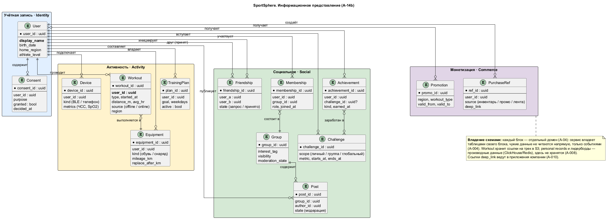

# А-14b. Информационное представление

> Исходник: `diagrams/d4_information.png`. Схема — логическая модель
> (ER); физические инстансы и регионы — в [А-14d](infrastructure.md).

## Домены данных (владение схемами)

| Блок на схеме | Домен | Таблицы | События наружу (ADR-004) |
|---------------|-------|---------|---------------------------|
| Учётная запись | Identity | User, Consent | `user.registered`, `consent.changed`, `user.purge_requested` |
| Активность | Activity | Device, Workout, Equipment, TrainingPlan | `workout.completed`, `equipment.mileage` |
| Социальное | Social (+Challenges) | Friendship, Membership, Group, Post, Challenge, Achievement | `group.posted`, `achievement.earned`, `challenge.enrolled` |
| Монетизация | Promo/Commerce | Promotion, PurchaseRef | `promo.delivered`, `purchase.converted` |

## Ключевые решения модели

1. **`Workout` — агрегат-якорь** (наработки `9.6`): владеет сессией,
   метриками и ссылкой на трек в S3; производные (личные рекорды,
   позиции в таблицах, статистика) **не хранятся здесь**, а считаются в
   Insights/ClickHouse/Redis (ADR-008) — чтобы не превращать агрегат в
   «свалку».
2. **Ссылки через `user_id`, не джойны между доменами**: чужие таблицы
   не читаются — только события (ADR-004). На схеме связи User↔чужие
   домены — это **ссылочная целостность внутри домена-владельца**
   (каждый домен хранит свой `user_id`), а не общий join.
3. **PII вынесены из модели доменов** (ADR-003): в доменных таблицах —
   только псевдонимы; сущности Consent живут в Identity, персональные
   атрибуты — в PII-хранилище (на схеме — как обещание модели).
4. **Приватность как данные**: Consent версионирован; видимость
   (профиль/маршруты/«сейчас») — атрибуты настроек, читаемые Social/Search
   по событию.
5. **`Equipment` связан с `Workout`** — пробег обуви накапливается из
   сессий (основа подсказки замены, КС-2); разрыв этой связи обнуляет
   Ц-2, поэтому она покрыта тестами целостности.
6. **`PurchaseRef`** хранит источник (`workout_hint/promo_banner/
   group_post`) — атрибуция Ц-2; сама покупка живёт в приложениях
   компании (ADR-010).

## Объёмы и жизненный цикл

| Класс | Состав | Рост (год 1 → 5) | Хранение |
|-------|--------|------------------|----------|
| Оперативные строки | Workout, Post, Group… | 0,7 → 6,5 млн записей/сут | PostgreSQL региона, партиции по месяцам |
| Треки/контент | GPS-сэмплы, медиа | 5 → 35 ГБ/сут | S3: hot 90 дн → холод (Parquet) |
| События Kafka | потоки доменов | 20 → 130 ГБ/сут | retention 7 дн (буфер), свёртка в ClickHouse |
| Аналитика | срезы сравнений | 2 → 25 ТБ | ClickHouse, партиции по региону/месяцу |
| Согласия/PII | Consent, профиль | растёт с базой, ≤ 1 % объёма | выделенный PostgreSQL + бэкап 3-2-1 |

Все числа согласованы с [А-16](../../stage3-risk-cost/16-tco.md).
