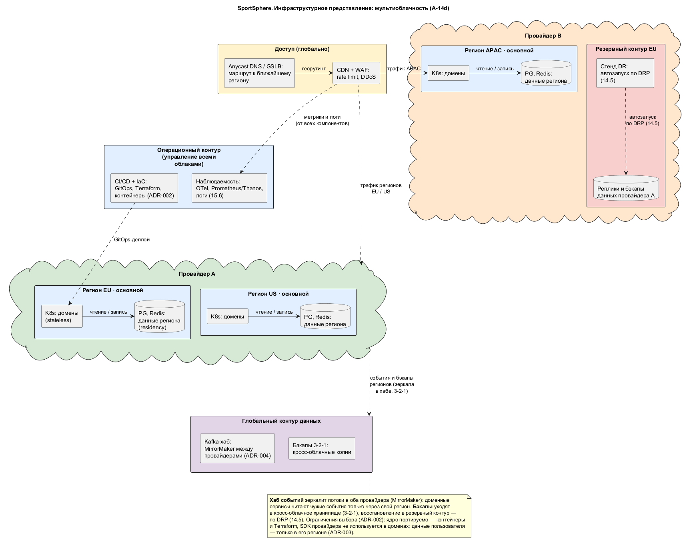

# А-14d. Инфраструктурное представление

> Исходник: `diagrams/d6_infrastructure.png`. Основа — ADR-002;
> наработки по отказоустойчивости и DRP — практика `14.5`.

## Топология

| Контур | Регион/роль | Содержимое |
|--------|-------------|------------|
| Доступ | глобально | Anycast DNS/GSLB (георутинг к ближайшему региону), CDN+WAF, квоты |
| Операционный | глобально | CI/CD + IaC (GitOps, Terraform, контейнеры), наблюдаемость (ADR-012) |
| Провайдер A · EU | основной | K8s с доменами, PostgreSQL/Redis региона (residency) |
| Провайдер A · US | основной | K8s, PostgreSQL/Redis региона |
| Провайдер B · APAC | основной | K8s, PostgreSQL/Redis региона |
| Провайдер B · DR EU | резервный контур данных провайдера A | стенд DR с автозапуском по DRP, реплики/бэкапы |
| Глобальный контур данных | — | Kafka-хаб (MirrorMaker), кросс-облачные бэкапы 3-2-1 |

## Принципы

1. **Портируемость**: разворачивание региона = workspace Terraform +
   узел GitOps; доменные сервисы не знают, в каком облаке живут
   (ADR-002, NFR-11).
2. **Residency**: данные пользователя — только в его регионе; между
   облаками — обезличенные события через хаб и бэкапы (ADR-003).
3. **Отказ региона**: GSLB уводит трафик в живой регион (чтение —
   реплика), DRP восстанавливает данные резервного контура; целевые
   RPO ≤ 15 мин / RTO ≤ 2 ч (NFR-09, практика `14.5`).
4. **Обновления без простоя**: rolling-деплой, canary для критичных
   доменов (NFR-02); конфигурация — Git, откат = откат коммита.
5. **Деградация по региону**: потеря non-critical функций (промо,
   подсказки) допустима; приём тренировок и статистика — нет (АК-1).

## Наблюдаемость инфраструктуры (ADR-012, практика `15.6`)

- Метрики регионов агрегируются глобально (Thanos-модель) — один дашборд
  «все облака».
- Логи: агенты узлов → буферизация → горячий индекс 14 дней → холод
  Parquet в S3 (PII отфильтрованы на агенте).
- Стандартные SLI: доступность API, лаг Kafka, ёмкость дисков, стоимость
  (метрики расходов → А-16).

## Стоимостная модель топологии

Структура расходов в А-16: три
основных региона дают ~85 % вычислительных затрат, глобальный контур
(хаб, бэкапы, наблюдаемость) — ~15 %; DR-контур — отдельная строка,
которую можно уменьшить «холодным» режимом (компромисс с NFR-09 —
см. А-15).
