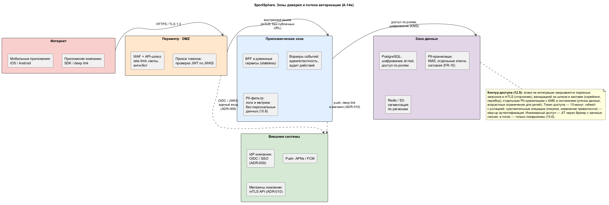

# А-14e. Представление безопасности

> Исходник: `diagrams/d7_security.png`. Зоны следуют ADR-005/009/003;
> векторы атак на интеграции — практика `12.5`.

## Зоны доверия

| Зона | Границы | Защитные механизмы |
|------|---------|--------------------|
| Интернет | всё, что снаружи | TLS 1.3, анти-бот, отсутствие прямых путей к сервисам |
| Периметр (DMZ) | WAF + шлюз + прокси токенов | rate limit/квоты (пользователь, партнёр), валидация JWT по JWKS, правила анти-скрейпинга |
| Приложенческая зона | stateless-сервисы и воркеры | mTLS между контурами, сетевые политики K8s (нет прямого выхода в интернет у доменов), PII-фильтр телеметрии |
| Зона данных | PostgreSQL, PII-хранилище, Redis/S3 | шифрование at rest (KMS), доступ по ролям, выделенный инстанс PII с отдельными ключами, сегментация по регионам |
| Внешние системы | IdP, push, магазины компании | JWKS-ротация, подписанные запросы + mTLS, ключи партнёров отдельно от пользовательских токенов |

## Потоки аутентификации и авторизации

1. **Вход пользователя**: OIDC (IdP компании) → access 15 мин (JWT) +
   refresh с ротацией; проверка на шлюзе (ADR-009, ADR-005).
2. **Step-up**: покупка, изменение приватности, выгрузка данных —
   повторное подтверждение (биометрия/PIN).
3. **Партнёрские вызовы**: приложения компании → mTLS + HMAC-подпись,
   квоты, ротация ключей (ADR-010).
4. **Сервис-к-сервису**: короткоживущие токены внутри контура, политики
   сетевых сетей; домены не выходят наружу (только через шлюз).
5. **Инженерный доступ**: JIT через брокер доступа с записью сессии,
   роли по доменам; прямого доступа к PII нет (АК-2).

## Модель угроз → защиты (по практике `12.5`)

| Вектор (интеграции) | Сценарий | Защита |
|---------------------|----------|--------|
| Подбор/перебор | атака на аккаунты, API | квоты шлюза, lockout, анти-бот, аномалии в SIEM |
| Скрейпинг каталога/профилей | выгрузка данных через API | rate limit по партнёру, подписи запросов, ротация |
| Компрометация ключа партнёра | подмена источника, фрод атрибуции | mTLS + HMAC, короткий TTL ключа, ревизия цепочки атрибуции |
| MITM / подмена клиента | перехват токенов, подделка позиций | TLS 1.3, пинирование шлюза, валидация аномалий потока (T-11) |
| Утечка PII через логи | выгрузка персональных данных «боком» | PII-фильтр на агенте (ADR-012), аудит обращений к PII (ADR-003) |
| Вредоносный UGC | токсичность, мошенничество в группах | автофильтр + очередь модерации (NFR-10), приоритет детского контента |

## Данные и возрастные режимы

- Согласия — версионированные записи (Art. 9 — отдельный флаг).
- Несовершеннолетние: урезанная видимость по умолчанию, согласие
  представителя, повышенный приоритет модерации (FR-15, UC-01/UC-13).
- Выгрузка ≤ 30 дней, удаление производных ≤ 7 дней (КС-7) —
  события очистки идут по шине (ADR-004).

## Аудит и реагирование

- Журналируются: обращения к PII, step-up, действия инженеров,
  решения модерации, ротации ключей → в тот же пайплайн логов
  (горячий слой 14 дней, холод — годами; ADR-012, практика `15.6`).
- Инцидентная лестница: обнаружение (SIEM-правила) → изоляция ключа/домена
  → уведомление DPO → постмортем с оценкой влияния на Ц-4.
